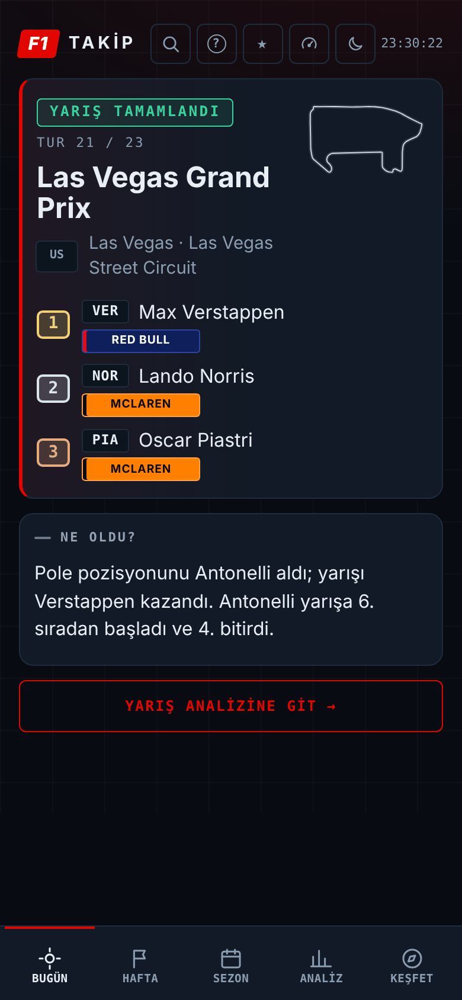
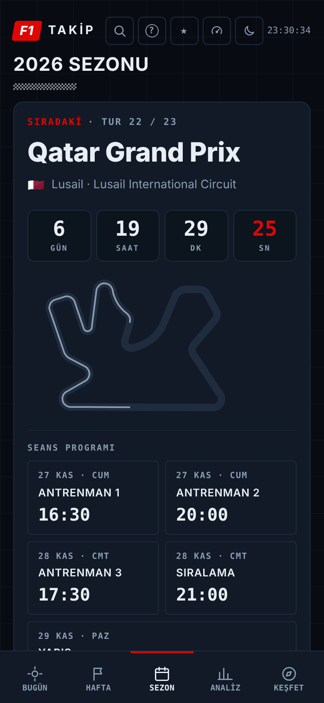
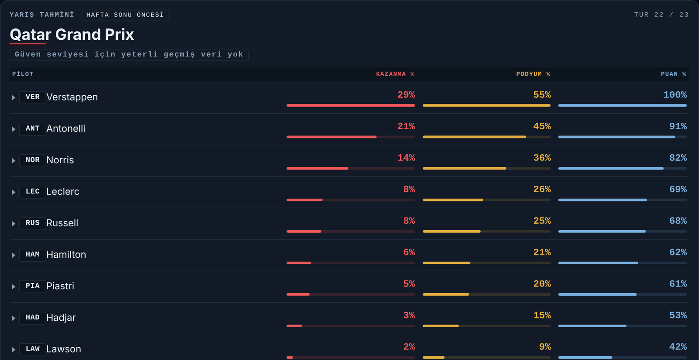
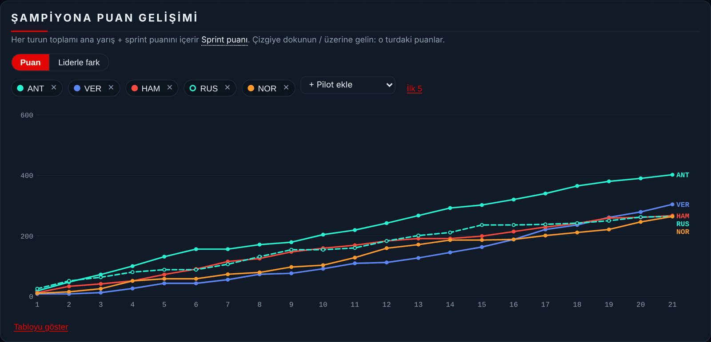
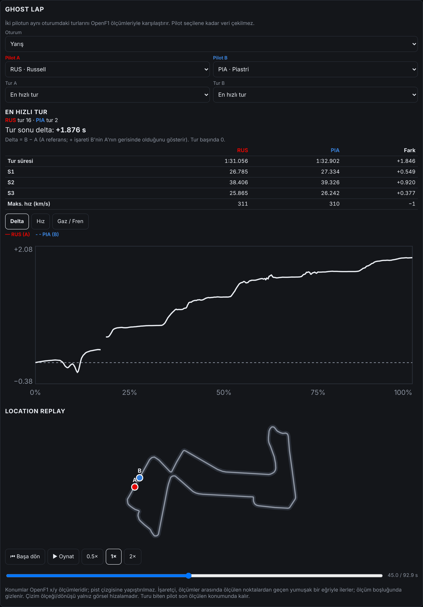

<div align="center">

# F1 TAKİP

**Formula 1 sezonunu tek ekranda takip et: bugün ne var, hafta sonu programı, puan durumu, yarış analizi ve tahminler.**

[**Canlı site → ncg0659.github.io/F1-Takip**](https://ncg0659.github.io/F1-Takip/)

Ücretsiz · reklamsız · hesap gerektirmez · iPhone'da ana ekrana eklenebilir (PWA)


</div>

---

## Ne yapar?

F1 TAKİP, açık F1 veri kaynaklarını kişisel ve sade bir arayüzde toplayan bir web uygulamasıdır. Telefonda bir uygulama gibi çalışır, internet yokken de en son açılan ekranlar görüntülenir.

| | |
|---|---|
|  |  |
| **BUGÜN** — yarış haftasının özeti, durum rozeti (LIVE, SC, VSC, RED FLAG…), podyum ve "Ne oldu?" | **SEZON** — sıradaki yarış, geri sayım, seans programı, takvim, puan durumu |

## Ana özellikler

- **BUGÜN:** O anın en önemli bilgisi tek kartta: sıradaki yarışa geri sayım, aktif seans, canlı durum ya da tamamlanan yarışın podyumu ve kısa özeti.
- **Yarış durumu:** LIVE, Safety Car, VSC, kırmızı bayrak, "yeniden başlama açıklandı" ve "yeniden başladı" ayrı ayrı gösterilir. Kesin bilgi yoksa durum "LIVE TAHMİNİ" olarak işaretlenir; kırmızı renk yalnızca gerçek kritik durumda kullanılır.
- **Race Feed:** Güvenilir F1 muhabirlerinin herkese açık notları Türkçeye çevrilerek özetlenir. Son 5 önemli not gösterilir, "TÜMÜNÜ GÖSTER" ile hepsi açılır; çevirisi bulunamayan not **EN** etiketiyle gösterilir.
- **HAFTA SONU:** Antrenman, sıralama, sprint ve yarış seansları Türkiye saatiyle, tamamlanan seansların sonuçlarıyla birlikte.
- **SEZON:** Takvim (pist silüetleriyle), pilot ve takım puan durumu, şampiyonluk hesaplayıcı, geçmiş şampiyonlar.
- **ANALİZ:** Şampiyona puan gelişimi, son 5 yarış formu, start/bitiş, pole → galibiyet, takım puanları, DNF ve pist türü performansı.
- **Favori pilot:** Seçtiğin pilot ekranlarda nötr bir vurguyla öne çıkar.
- **Sezon arası:** Yeni sezonun takvimi henüz yayınlanmadıysa hata yerine "SEZON ARASI" bilgisi gösterilir. Geçen yılın puanları yeni yılınki gibi gösterilmez.

## Öne çıkan modüller

### Yarış tahmini
Her pilot için kazanma, podyum ve puan olasılığı hesaplanır. Hesap, açıklanabilir ve ağırlıklı bir skora dayanır: son form, sıralama formu, grid, takım formu, güvenilirlik, pist geçmişi ve takım arkadaşı farkı. Ağırlıklar geçmiş sezonlarda geriye dönük test edilerek ayarlandı.

Tahmin hafta sonu öncesinde bir kez, sıralamadan sonra da grid hesaba katılarak bir kez daha yapılır. Yarış başladığında **sabitlenir** ve canlı sonuçlarla değişmez.



### Analiz merkezi


### Ghost Lap
İki pilotun en hızlı turu yan yana karşılaştırılır: tur süreleri, sektör farkları, delta, hız ve gaz/fren grafikleri, pist üzerinde konum oynatma (0.5× / 1× / 2×, kaydırma). Konumlar OpenF1'in ölçtüğü gerçek x/y noktalarıdır. Ölçüm boşluğunda veri uydurulmaz; işaretçi gizlenir.



## PWA ve çevrimdışı

- iPhone Safari'de **Paylaş → Ana Ekrana Ekle** ile uygulama gibi açılır (tam ekran, uygulama simgesi).
- Uygulamanın tüm yerel dosyaları Service Worker ile önbelleğe alınır; internet yokken arayüz açılır. Yeni sürümde eski önbellek otomatik silinir.
- Canlı veriler (API yanıtları) önbelleğe alınmaz, her zaman kaynaktan istenir. Grafik kütüphanesi yüklenemezse grafiğin yerine açıklama gösterilir.
- Cihazda "Hareketi Azalt" açıkken açılış animasyonu ve kayan yazılar kapanır.

## Veri kaynakları

| Kaynak | Kullanım |
|---|---|
| [Jolpica F1 API](https://github.com/jolpica/jolpica-f1) (Ergast uyumlu) | Takvim, sonuçlar, sıralama, puan durumu |
| [OpenF1](https://openf1.org) | Telemetri, tur ve konum verisi (Ghost Lap) |
| [Bluesky](https://bsky.app) herkese açık gönderileri | Race Feed notları (Chris Medland, Albert Fabrega) |
| [Open-Meteo](https://open-meteo.com) | Pist hava durumu |
| [bacinger/f1-circuits](https://github.com/bacinger/f1-circuits) (MIT) | Pist silüetleri. Bkz. [NOTICE-pist-geometri.txt](NOTICE-pist-geometri.txt) |
| [F1DB](https://github.com/f1db/f1db) (CC BY 4.0) | Tahmin motorunun geriye dönük testi; bu sayfadaki ekran görüntülerinin verisi |

Eksik veri gösterilmez ya da "veri yok" olarak işaretlenir; tahmin edilip doldurulmaz.

## Teknik yapı

- Saf **HTML + CSS + JavaScript**: derleme adımı, framework ve sunucu yok. GitHub Pages'te statik olarak yayınlanır.
- Modüler dosyalar: veri katmanı (`hafta-veri.js`, `telemetry-data.js`, `prediction-data.js`), yarış durumu motoru (`hafta-state.js`), tahmin motoru (`prediction-engine.js`), ekranlar (`bugun-v3.js`, `hafta-ui.js`, `sezon-takvim.js`, `analiz-merkezi.js`, `ghost-lap.js`) ve hareket katmanı (`motion-v2.js`).
- Tahmin geçmişi cihazda saklanır (`prediction-snapshot.js`, localStorage). Hesap veya sunucu gerekmez.
- Ücretsiz kaynaklarla çalışır: ücretli servis, reklam ya da takip kodu yoktur.

## Proje durumu

- **Web / PWA:** Aktif olarak kullanılıyor ve geliştiriliyor.
- **Pist silüetleri:** 25 pistin hepsi kaynak veriyle birebir; ayna veya bozulma yok. 10 pist coğrafi kuzey-yukarı yönde. 15 pist ekrana daha iyi sığsın diye döndürüldü; bu yönler resmî yayın haritalarıyla henüz karşılaştırılmadı.
- **Native iOS (Live Activities):** Ayrı bir çalışma olarak hazırlık aşamasında.

## Geliştirme ve test

```bash
bash testler/calistir.sh            # tüm çekirdek testler (Playwright + Node)
bash testler/calistir.sh bugun_v3_test   # tek test dosyası
```

- Testler gerçek tarayıcıda, sahte saat ve kayıtlı API yanıtlarıyla çalışır. 390 px ve masaüstü, koyu ve açık tema, yatay taşma ve konsol hatası kontrol edilir.
- `testler/` klasörü sitede yayınlanmaz.
- README görselleri `testler/vitrin/vitrin_uret.py` ile, uygulamanın kendisi ve F1DB verisi kullanılarak yeniden üretilebilir.

---

<sub>F1 TAKİP resmî değildir; Formula 1, F1 ve ilgili markalar sahiplerine aittir. Veriler üçüncü taraf açık kaynaklardan alınır ve gecikmeli veya eksik olabilir.</sub>
